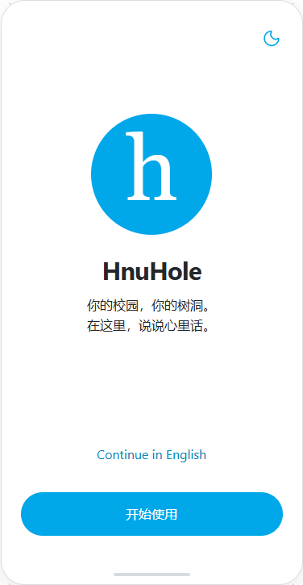
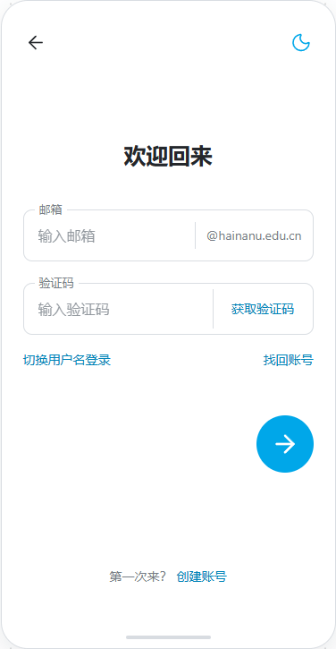
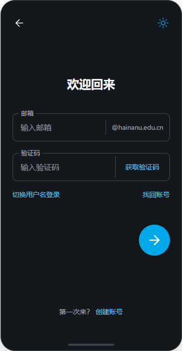

# 登录注册流程 UI 定稿

> 2026-10-21 当前注册设计：用户已确认[三步注册 v3](registration-v3/registration-three-steps.png)（“可以，就这样”）。index.html／source.html 已保存：邮箱验证→用户名密码→账号安全，恢复码框内复制、移除“暂不设置”、Passkey可选。欢迎／登录延续原确认版。仅本地设计获确认，产品、Sites、APK未更新；[核对记录](registration-v3/verification.json)与[评审](../ui-reviews/registration-wizard-v3.md)。v2及旧版Git b80452c保留。

> 实施更新：[PR #42](https://github.com/zewbby/HnuHole/pull/42)已将v3接入Flutter现有注册流程，恢复码点击复制、完整确认及可选通行密钥入口均已实施；[实际核对](../validation/registration-wizard-20261021/verification.json)。上方“产品未更新”仅描述设计确认当时；已合并main `09498b2`，五项CI通过，[合并回执](../validation/registration-wizard-20261021/main-merge.json)已核对；Sites仍保留原发布版本。

定稿日期：2026-10-21（Asia/Shanghai）。任务：`AUTH-UI-FINAL-01`。

用户确认当前交互稿“定稿然后推送到 GitHub 上，作为整个登录注册流程的定稿”。本目录是后续欢迎、登录、注册和账号恢复界面的视觉与交互基准；其中用户名／邮箱登录的原位切换，以最后一次修订为准。

状态：**DESIGN_APPROVED**。本次归档设计资产与说明，没有实现 Flutter 页面或新增认证接口，也不表示已合并 main、完成设备验收或发布。

## 定稿文件

- [交互稿 index.html](index.html)：下载到本地后用浏览器打开；所有样式和图标随文件提供，无需服务器。GitHub 文件页只展示源码，不会直接运行交互稿。
- [可编辑源稿 source.html](source.html)：与用户最后确认的对话内源稿保持一致。
- [归档核对记录 verification.json](verification.json)：源稿摘要、实际浏览器检查、布局测量与截图摘要。
- [第三方许可](THIRD_PARTY_NOTICES.md)：独立交互稿内嵌的固定版本图标与展示依赖。
- [分支交付记录](../../branches/docs-auth-flow-final.md)：范围、推送／PR 状态和后续入口。

交互稿不连接账号服务，不发送邮件、不访问设备通行密钥、不执行登录或创建账号，也不保存输入的用户名、密码、邮箱或验证码。交互状态仅记录当前页面、登录方式、语言和主题。

独立文件由源稿导出后封装展示依赖，不再请求 CDN。导出容器仅为本地演示表单启用提交事件，表单处理会取消真实提交，且内容安全策略继续限制 `form-action 'none'`；此兼容调整不改变已确认的源稿或页面设计。

## 已确认页面

| 欢迎页 | 用户名与密码 |
| --- | --- |
|  |  |

| 原位切换为邮箱与验证码 | 邮箱模式深色 |
| --- | --- |
|  |  |

[窄屏截图](assets/email-narrow.png)。截图取自本目录交互稿，不使用包含个人信息的参考图片或视频。

## 欢迎页

- 未登录入口先展示品牌欢迎页。中间为 Logo、HnuHole 名称与短句；底部为语言切换和“开始使用”；右上角为月亮／太阳主题切换。
- 当前文案：“你的校园，你的树洞。／在这里，说说心里话。”中英文切换同步更新界面，明暗主题覆盖背景、文字、输入框和控件。
- 点击“开始使用”进入统一登录页；不保留单独的“登录或注册”入口框，不放无内容对应的轮播圆点。
- 圆形 h 图形是已确认布局中的占位标志，**正式 Logo 图形尚未设计**；本次不将占位图宣称为正式品牌标志。

## 登录页：原位切换

这是本轮最终修订，替代早期“切换后进入独立邮箱页”的方案。

1. 标题固定为“欢迎回来”。不显示“使用你的私有用户名和密码”，也不显示“登录后，本账号在其他移动设备上的会话将退出”这一行。
2. 默认上框“用户名”，下框“密码”；不使用“私有用户名”作为可见标签。密码框右侧保留显隐图标。
3. 点击密码框下方左侧“切换邮箱登录”，**仅在原位置替换两个输入框**：上框“邮箱”，下框“验证码”；“获取验证码”位于第二个框内部右侧。邮箱框保留固定 `@hainanu.edu.cn` 后缀。
4. 切换后标题、两个框的位置／大小、找回账号、底部创建账号及右下角箭头位置不变。没有独立邮箱页面、附加标题、副标题、邮箱填写说明或额外确认步骤。
5. 原切换入口变成“切换用户名登录”，点击原位切回。切换时清空密码和验证码，不将这些输入写入交互状态。
6. “找回账号”在输入区下方右侧；“第一次来？ 创建账号”在页面底部。两种登录方式共用这些入口。
7. 右下角仅显示圆形箭头，不在箭头旁增加“登录”两字。圆形按钮从 58 增大至 64，箭头图标为 32；其他页面继续沿用同类控件。

## 整个注册与恢复流程的统一基准

注册和恢复继承本稿的整页留白、细描边输入框、浮动标签、蓝色文字入口、圆形继续按钮与明暗主题。取消顶部带框的“登录／新注册／恢复账号”模式切换栏，通过文字入口进入对应流程。

| 流程 | 顺序与适用范围 |
| --- | --- |
| 欢迎／登录 | 欢迎页 → 同一登录页选择用户名密码或邮箱验证码 → 完成真实认证后进入推荐首页。有效会话恢复不强制重新展示欢迎页。 |
| 创建账号 | 校邮验证 → 设置用户名及独立密码 → 展示并保存恢复码 → 隐藏原码后完整确认 → 完成开户并按现有协议主动登录。校邮验证和开户状态机仍以现有协议为准。 |
| 找回账号 | 从“找回账号”主动进入 → 使用既有恢复码，或用户主动选择通行密钥 → 重设密码 → 保存并完整确认新恢复码 → 按现有协议主动登录。 |

交互稿可查看欢迎页、两种登录方式、注册入口与恢复入口；验证码验证、开户、恢复码展示／确认等后续页面未在本稿中伪造运行结果。上述后续步骤沿用既有账号协议与统一视觉，独立页面的内容细节需要在实际接入时核对，不将入口示意冒充完整认证实现。

正常登录界面保持本次确认的简洁文案。请求中、错误、投递未知、锁定及会话异常等真实状态按现有认证协议展示必要提示；不能因常态说明行被删除而丢掉错误处理或改变单设备会话、恢复与注销规则。

## 规格与接入边界

- 两个登录输入框等高，设计值 58；间距 24。账号模式切换时，标题、输入框、继续按钮与底部入口的几何位置保持一致。
- 主按钮与品牌色沿用交互稿。页面内容不包在登录卡片中；截图外侧的圆角手机边界属于展示容器，不是 App 内的登录框。
- 输入框保留焦点状态；图标按钮有可访问名称，验证码使用数字键盘，所有入口可用键盘操作。键盘弹出时应保证当前输入与继续操作可见。
- 中英文、明暗与窄屏属于同一设计。App 是否已支持持久偏好、系统主题与语言，不以演示交互代替原生实现或验收。
- **邮箱验证码登录是本次确认的界面需求，当前主线的校邮验证码协议只用于新账号准入。**现有 [账号规则](../modules/accounts.md)、[架构决策](../auth-privacy-architecture-decision.md)、[注册协议](../auth-privacy-registration-protocol.md)和 [C/V 契约](../auth-privacy-data-api-contract.md)不会因本设计归档而自动变化。实际接入前需明确邮箱登录对应的账号绑定、C/V 隐私边界、会话签发及错误处理；不能把注册验证码接口包装成已有账号登录，也不能把邮箱原文写入社区库。
- 本次没有修改 `apps/mobile`、Go 服务、OpenAPI、数据库、原生凭据或设备环境；后续实现应从届时最新 main 独立开分支，以本目录核对 UI。

## 验证与状态

归档核对以 [verification.json](verification.json) 为准：导出文件的实际浏览器运行、原位切换几何一致、两种方式往返、获取验证码示意、语言／主题切换、窄屏与运行错误检查，以及源稿与用户确认稿一致性。

App 编译／单元测试、真实邮件／登录／注册、SQL、Android／iOS 和生产验收均为 `NOT_RUN`：本任务只交付设计，不提升任何产品模块验收结论。仓库协作检查另记于[分支交付记录](../../branches/docs-auth-flow-final.md)。
