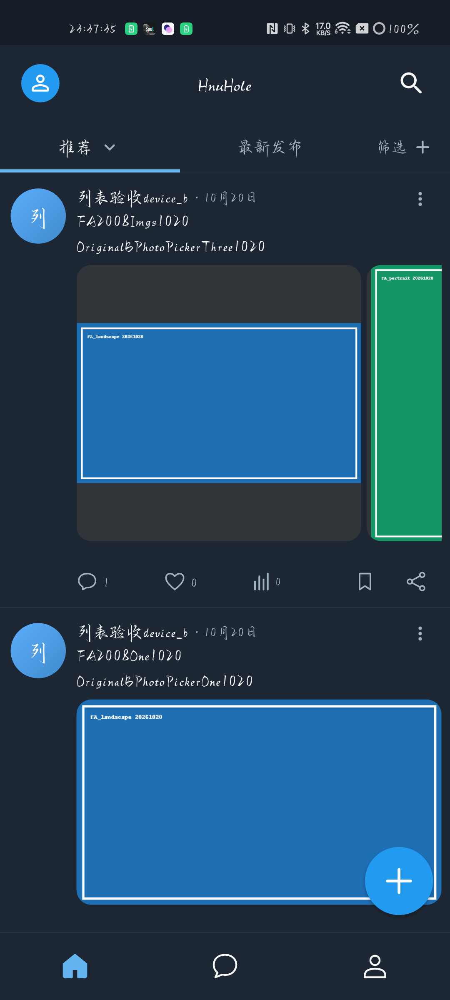
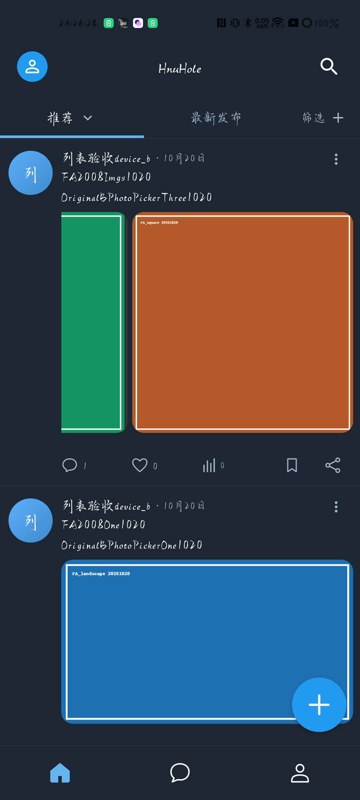
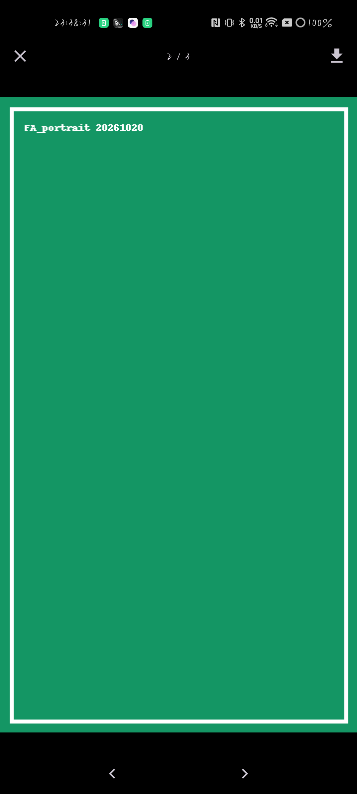
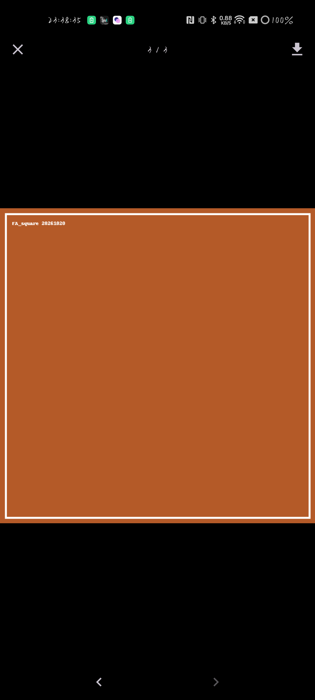
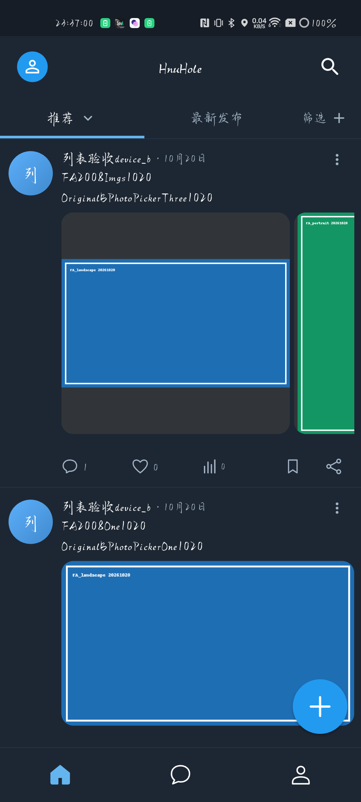

# 新版列表真机 profile 性能补验

工作项 `FEED-PERF-WORKER-SUPPORT-01`，属于 [Draft PR #36](https://github.com/zewbby/HnuHole/pull/36) 的补充交付。源码修复 `57dfe5f`，实际 profile 构建／设备版本 `31bc061`／2026102012；本次仅更新证据文档，无新增运行代码。PR 未合并、没有新合并授权，main `30401b8` 仍含 FA-D08；未正式发布。

可信公网 C/V 双腿在用户关闭 TUN 后由环境负责人验证可用。profile 只编译两项公开 origin，使用系统信任根，不含开发 CA／RP；原 C/V、Gate、权限和媒体 60 秒 lease 未变，后端 `c923fa5a`／C21/V4。此前隧道不可达、TLS 失败与准备阶段 BLOCKED 保留原时点。

## 实际结果与口径

Android 独占操作 realme RMX3366／Android 14 API34，沿用字体、密度和亮暗设置。预先冻结计划 SHA256 `c075cb6824ae59fd718a80cdb18b1154632fa44cdcfe444d3ffff4a8f5d674f0`，每场景一次 warmup、三窗各 20 秒；实测 60.000004 Hz，帧预算 16.6666656 ms。直接采集 stock `Flutter.Frame` 的 build／raster，独立计算，不把 elapsed 当 UI 时间或相加流水线阶段。

| 场景 | 有效帧 | build p95／p99 ms | raster p95／p99 ms | 任一阶段超预算 |
| --- | ---: | ---: | ---: | ---: |
| S1 列表慢／快纵滚 | 3121 | 1.872／3.001 | 4.245／5.025 | 0% |
| S2 图文列表往返滚动 | 3024 | 1.475／1.883 | 3.967／4.707 | 0% |
| S3 原三图横轨 | 2198 | 2.637／3.166 | 4.140／4.760 | 0% |
| S4 查看器缩放／平移 | 1040 | 1.547／1.908 | 3.179／3.714 | 0% |

9,383 帧全部达到预设 p95≤B、p99≤2B、超预算≤5%、单阶段最大≤250ms 的单设备预算。另用原按钮补 20 秒翻页证明：页 2 绿色、页 3 棕色的原 PNG／语义页码及返回列表均确认，628 帧的 build p95／p99 5.067／8.875 ms、raster 3.791／4.356 ms，独立保留，不混入四场景三窗计数。前端只读核对原件 SHA、唯一帧、采集错误及分位数，与 Android 汇总一致。

10 次原图开关、回同列表静置 30 秒，不强制 GC；有效 memory2 的 PSS 暖基线 230,196 KiB、末三次中位数 230,275 KiB，增量 79 KiB，小于 max(30MiB,20%) 的 46,039.2 KiB，末尾原图仍可访问。Dart 堆、GC、Java／native heap、PSS 原件保留。原 memory1 虽增量 804 KiB 达数值预算，但末尾跨 lease 失效，保留为无效暖素材证明。

同一 PID 自启动未变，未观察到崩溃／ANR，当前 PID 日志 fatal／ANR 0；全局 thermal status 0。原始 OEM soc sentinel mStatus6 和传感器数据保留，不据此承诺所有传感器无节流。设备采集已结束，自有采集转发／临时文件由 Android 负责人收回；前端没有操作设备、网络或共享环境。

## 无效窗口与适用边界

只替换 S1 误入详情的一窗、S2 被 SystemUI 中断的一窗及跨 lease 的内存协议；旧有效窗不重跑。冷启动／warmup、最初 lease 失效窗和无效翻页 probe 均单列。Max 确认截图是 `image_outlined` 加载占位；没有原始触点／导航时序，不能把误入详情归因产品手势或驱动。将采样横坐标改为 100 是输入修正，未宣称产品修复。没有确认新的源码阻断。

这是实际受保护网络媒体、离屏重挂／重新请求包含加载中的单设备限定证据，不是纯 GPU、网络延迟、全机型或生产 SLA 通过。profile 是主要模式；未构建 release2013，也不重复同套 release 场景。旧 76 项影响回归／分析、debug2011 原任务重试及最终 31bc061 产品 CI，按未变的 110 项运行输入复用；此次文档最终 HEAD 的必要 CI 单独核实。

## 候选与复现交付

`feed-performance-profile-31bc061-2026102012.apk`，42,045,645 bytes，SHA256 `72a3f2511e3603f0a1e2f263e68c7e7bebdb464bbfe5370a42cd17b76deb28b0`；测试证书 `adebd158e30b0d7dfbd38bd95664aa2d1afd9c88bd824a6ca3e61abf109290ea`。AOT `libapp.so` SHA256 `32048c5e4a13dd107d1574e1cbfa1bac6781fa19404f7990680ac33b4d1afdd2`；symbols ZIP SHA256 `fd02024302088f8d0e41ee2669acad324ac1dd3257574157f8d6983ce68009df`。

构建模式链已更正核实：SDK stock profile engine 等于 mergedNativeLibs，AGP strip 后等于 APK engine；profile VM service snapshot 存在、debug kernel 不存在。早先直接比较未 strip SDK 与 APK 的失败记录保留，无重构包。原元数据对五张 launcher PNG 错做 CRLF 归一化，另补 110 项真实字节 SHA 与 Git 二进制 blob 一致性回执；原元数据不覆盖，APK／旧 ZIP SHA 一直按真实字节计算。

详见[机器验证与原件摘要](feed-profile-performance-verification-20261020.json)、[原失败任务修复](../branches/fix-comment-failure-reconcile.md)。构建配方、公开原始帧／动作、无效样本、修正回执、候选与符号归入独立补充交付包；密钥、token、VM auth URI 和 private 采集日志不入包。旧 debug2011 交付包保持不变。最终文档提交号、必要 CI 和 ZIP SHA 以 PR 及交付回执为准，不自引用未生成的提交。

## 实际渲染原件

Android 负责人批准公开、前端逐张复核的自有合成内容原图；无加工，原 SHA 见机器记录。

